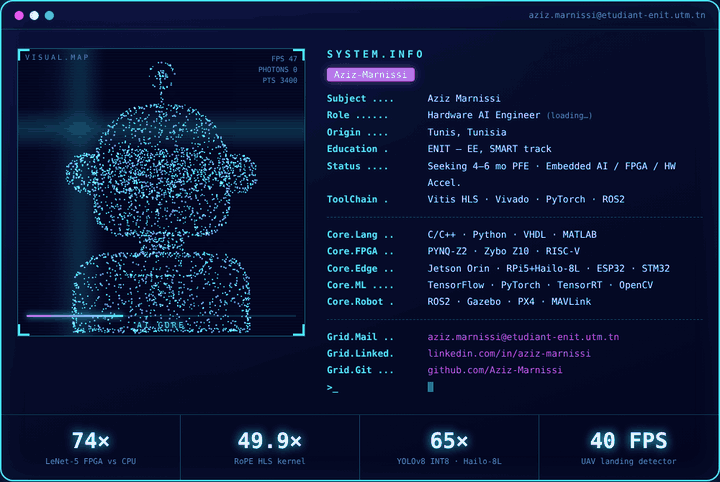

<table>
<tr>
<td width="46%" valign="top"></td>
<td valign="top">

```ini
[ SYSTEM.INFO ]
Subject ...... Aziz Marnissi
Role ......... Hardware AI Engineer
Origin ....... Tunis, Tunisia
Education .... ENIT · EE · SMART track
Status ....... Seeking 4–6 mo PFE
Focus ........ Embedded AI · FPGA · HW Accel.

[ CORE ]
Lang ......... C/C++ · Python · VHDL · MATLAB
FPGA ......... PYNQ-Z2 · Zybo Z10 · RISC-V
Edge ......... Jetson Orin · RPi5+Hailo · ESP32
ML ........... TensorFlow · PyTorch · TensorRT
Robotics ..... ROS2 · Gazebo · PX4
```

</td>
</tr>
</table>

<p align="center">
  <b>74×</b> LeNet-5 FPGA &nbsp;·&nbsp; <b>49.9×</b> RoPE HLS &nbsp;·&nbsp; <b>65×</b> YOLOv8 INT8 Hailo &nbsp;·&nbsp; <b>40 FPS</b> UAV landing
</p>

<p align="center">
  <a href="https://linkedin.com/in/aziz-marnissi">LinkedIn</a> ·
  <a href="mailto:aziz.marnissi@etudiant-enit.utm.tn">Mail</a>
</p>
